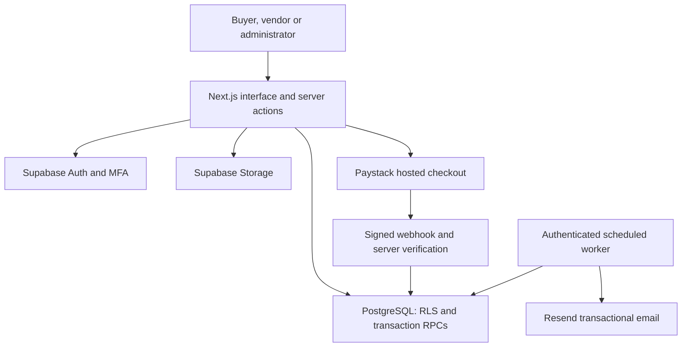

# Architecture

## Trust boundaries

- User authentication uses `getUser()`; session refresh uses the Supabase SSR proxy.
- All private data is protected by RLS in addition to route-level checks.
- Users cannot write role fields, financial balances, payment state or immutable order snapshots.
- Admin checks require both a protected role and an AAL2 claim in PostgreSQL.
- Service-role use is restricted to payment verification, background jobs and provisioning.
- Payments compare canonical server totals and unique references in one transaction.
- Public product images and private financial data use different access controls.

## Financial rules

A checkout creates one parent order and one suborder per vendor, then reserves physical stock. Services do not decrement stock. Paystack success converts reserved stock into sold stock. On expiry, holds are released. Late payments are recorded as requiring refund. A database lock serializes confirmation and expiry of the same order.

Only the buyer can confirm receipt, and only after the vendor marks the order ready. Confirmation credits a single net-sale ledger entry. Open disputes prevent completion. A withdrawal locks the store balance and debits a reservation immediately. Rejecting a requested withdrawal reverses that reservation once. “Paid” is an operator attestation requiring an external transaction reference, not a simulated bank transfer.

## Background jobs

The outbox stores email jobs within the same transaction as the business event. The worker claims rows with `FOR UPDATE SKIP LOCKED`, uses a bounded lease, and retries failures with backoff. Provider-level email deduplication complements database state. Failed jobs require operator review.

## Limitations

The current UI returns bounded lists (60 catalogue listings, 50 buyer orders, 100 operational records). Cursor pagination and scalable analytics are required before a large launch. No worker or database is provisioned by merely cloning this repository.
